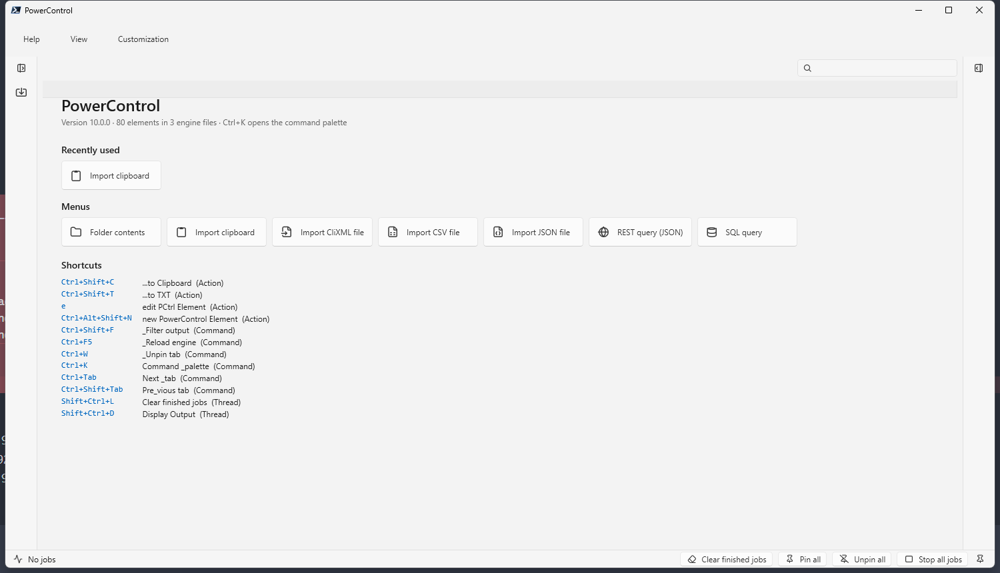
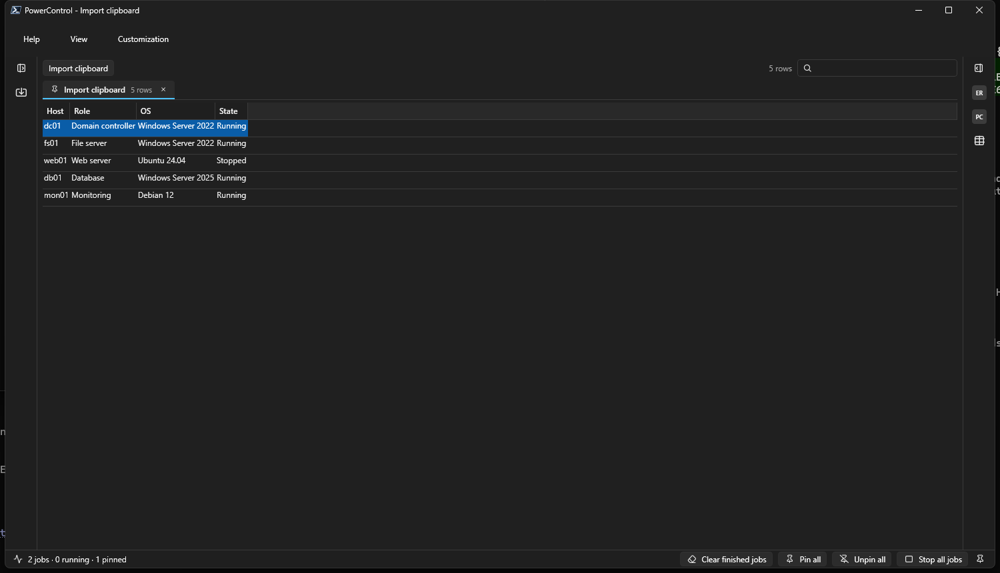
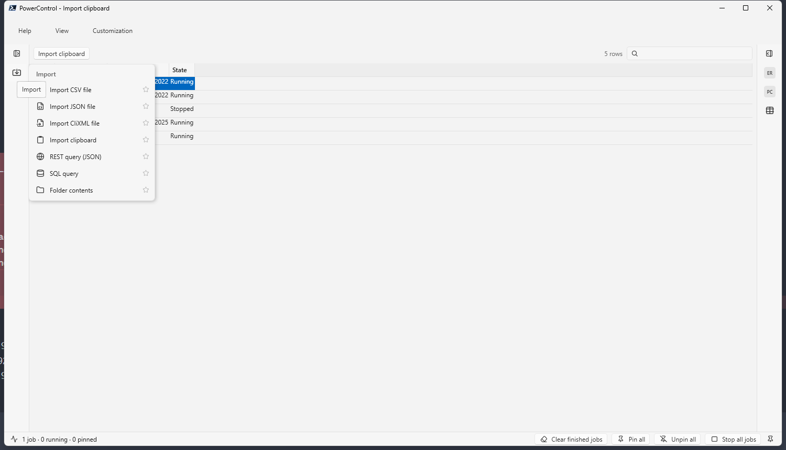
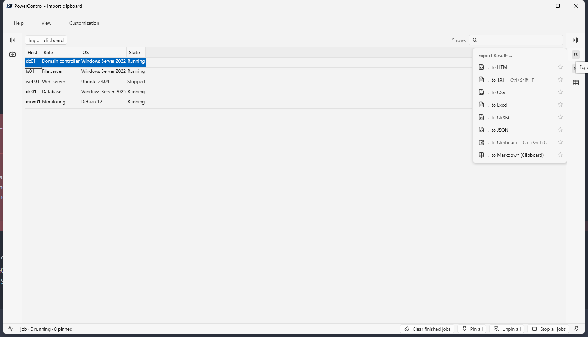
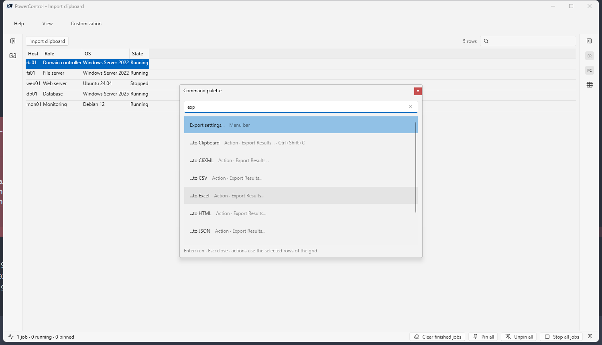
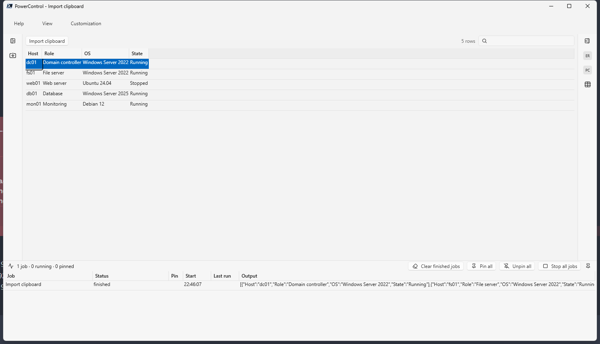
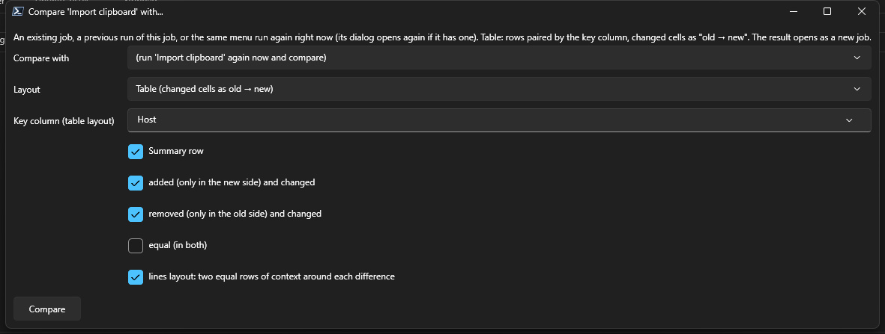
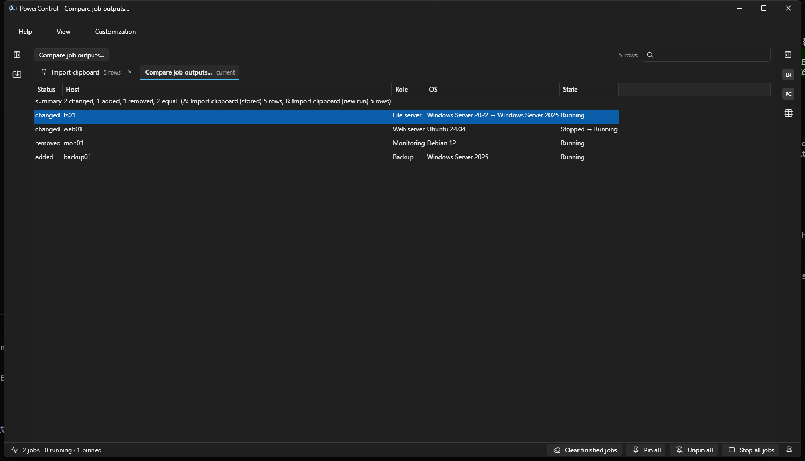
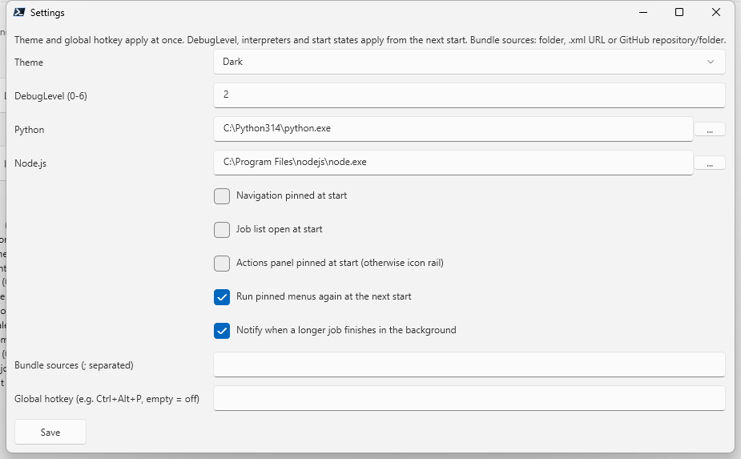
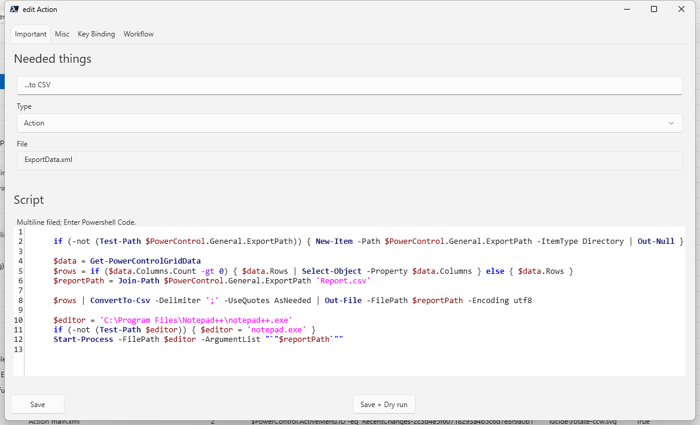

# PowerControl

PowerControl ist eine PowerShell-7/WPF-Oberfläche, die kleine, in XML beschriebene Bausteine zu einer
Werkzeugsammlung macht: Menüs liefern Zeilen, Aktionen arbeiten auf den markierten Zeilen, Jobs laufen im
Hintergrund und blockieren nie das Fenster, und drumherum gibt es alles, was man dafür braucht (Filter, Export,
Import, Vergleich, Wiederholung, Favoriten, Bundles).

Neue Menüs und Aktionen entstehen direkt in PowerControl: `Customization > Create a new element` öffnet den
Element-Editor (Skript mit Syntaxprüfung, Icon-Auswahl, Tastenkürzel, Workflow, Kinder), speichert das Element in
eine Engine-Datei, und es erscheint sofort. Wer ein paar Zeilen PowerShell schreiben kann, ist in Minuten fertig.
Die XML-Dateien in `engine\` lassen sich auch von Hand bearbeiten, Python- und Node.js-Skripte hängen sich genauso
ein. Kein Build, keine Modul-Installation.

[English version: README.md](README.md)



## Voraussetzungen

| Komponente | Version |
|------------|---------|
| Windows | 10 / 11 (die Oberfläche ist WPF; die Engine selbst ist portabel, siehe `-Headless`) |
| PowerShell | 7.6 oder neuer (x64; das Fluent-Theme braucht .NET 10 WPF) |
| Optional | Python 3 und/oder Node.js 18+ für Elemente, die `Invoke-PowerControlExternal` nutzen |

Der Code-Editor (AvalonEdit) liegt in `dll\`.

## Schnellstart

```powershell
git clone <dieses Repository>
cd PowerControl
pwsh -NoProfile -ExecutionPolicy Bypass -File .\PowerControl.ps1
```

Der erste Start legt `ini\settings.json`, `temp\` (Element-Index, Icon-Cache) und `Logs\` mit Standardwerten an:
Theme wie Windows, Navigation und Aktionen als Icon-Leisten eingeklappt, DebugLevel 2.

Nützliche Parameter:

```powershell
.\PowerControl.ps1 -Theme Dark                              # Light | Dark | System | Settings
.\PowerControl.ps1 -Run 'Recently changed'                  # Element direkt nach dem Start ausführen
.\PowerControl.ps1 -Headless -Run 'Import clipboard'        # ohne Fenster, Zeilen gehen in die Pipeline
.\PowerControl.ps1 -Headless -Run 'List all PCtrl Elements' -OutFile out.json   # .json | .csv | .xml | .txt
.\PowerControl.ps1 -DebugLevel 5                            # ausführliche Logs in Logs\
```

## So funktioniert es

Jede Datei in `engine\*.xml` ist eine Liste von `PCtrl`-Elementen. Der Typ entscheidet, wo das Element auftaucht:

| Typ | Erscheint als | Skript bekommt | Skript liefert |
|-----|---------------|----------------|----------------|
| `Menu` | Navigationsleiste / Baum, Startseite, Palette | nichts (oder einen Dialog) | Zeilen über `$Script:PowerControlItem_Output` |
| `MenuBar` | Eintrag im oberen Menü (`View`, `Customization`, ...) | nichts (oder einen Dialog) | Zeilen |
| `Action` | Aktionsleiste, angeboten für die Zeilen, auf die die `DisplayCondition` passt | `$script:SelectedEntries` | Zeilen (werden die Ausgabe des Jobs) |
| `Thread` | Kontextmenü der Job-Liste (Tabs, Breadcrumbs); `Toolbar="Jobs"` setzt es auf die Job-Leiste | die markierten Jobs | nichts (arbeitet auf den Job-Objekten) |
| `Command` | Tastenkürzel der Oberfläche (Strg+K, Strg+Tab, ...) | nichts | nichts, meist `Invoke-PowerControlUICommand` |
| `OutputGridHeaderMenu` | Rechtsklick auf einen Spaltenkopf | die Spalte | nichts |
| `EditTreeView` | der Element-Editor | das Element | nichts |

Ein minimales Menü:

```xml
<PCtrl type="Menu" Label="Services" ID="Services-0001" Icon="lucide\server.svg" ToolTip="Laufende Dienste">
  <Script><![CDATA[
    $Script:PowerControlItem_Output += Get-Service | Where-Object Status -eq Running |
        ForEach-Object { [PSCustomObject]@{ Name = $_.Name; DisplayName = $_.DisplayName } }
  ]]></Script>
</PCtrl>
```

Eine Aktion dazu (die `DisplayCondition` wird für jede markierte Zeile als `$_` ausgewertet):

```xml
<PCtrl type="Action" Label="Restart service" ID="RestartService-0001" Icon="lucide\refresh-cw.svg">
  <DisplayCondition Categorie="Services" SortOrder="1"><![CDATA[ $null -ne $_.Name -and $null -ne $_.DisplayName ]]></DisplayCondition>
  <KeyBinding Key="R" Modifiers="Ctrl+Shift" />
  <Script><![CDATA[
    foreach ($row in @($script:SelectedEntries)) { Restart-Service -Name $row.Name; $Script:PowerControlItem_Output += [PSCustomObject]@{ Name = $row.Name; Result = 'restarted' } }
  ]]></Script>
</PCtrl>
```

Weitere Attribute und Kindknoten: `Children` (kommagetrennte IDs für Gruppen und Untermenüs), `PrevAction` /
`NextAction` mit `Priority` (Ketten von Elementen, siehe "Workflows" unten), `ApartmentState="STA"` (Dialoge,
Zwischenablage), `KeyBinding`, `Toolbar="Jobs"`. Jedes Skript läuft in einem eigenen Runspace; ein hängendes
Skript friert nie das Fenster ein, die Job-Liste zeigt es, `Stop` beendet es.

Dialoge werden als Hashtable beschrieben und vom eingebauten Dialog-Builder gezeichnet, siehe nächster Abschnitt.

Andere Sprachen: `Invoke-PowerControlExternal -Language Python|Node -InputObject $rows -Code '...'` schickt die
Zeilen als JSON an stdin und macht aus jeder JSON-Zeile auf stdout eine Tabellenzeile. Interpreter-Pfade werden
automatisch gefunden oder unter `View > Settings` gesetzt.

## Der Dialog-Builder

Die meisten Elemente brauchen vor der Arbeit ein paar Eingaben: eine Datei, ein Trennzeichen, eine Auswahl, ein
Häkchen. Dafür jedes Mal XAML zu schreiben will niemand, deshalb bringt PowerControl einen Dialog-Builder mit. Du
beschreibst den Dialog als Hashtable, rufst `Show-PCtrlGUI` auf und bekommst die Werte als `$GUIResults` zurück. Der
Builder zeichnet das Fenster im aktuellen Theme und kümmert sich um Validierung, Standard-Button, Enter/Esc,
Dateiauswahl und Icon-Vorschau.

### Einbau in ein Element

Der Builder steckt in der Aktion `Draw GUI` (`engine\main.xml`). Ein Element, das einen Dialog will, trägt sie als
`PrevAction` ein; die Kette läuft dann STA, das Element selbst braucht kein weiteres Attribut:

```xml
<PCtrl type="Menu" Label="Import CSV file" ID="ImportCsv-0001" Icon="lucide\file-spreadsheet.svg">
  <PrevAction ID="DrawGUI-e7670e8344194a828558f726" Priority="100" />
  <Script><![CDATA[
    $GUItable = @{
      'window' = @{ 'title' = 'Import CSV'; 'description' = 'Die erste Zeile der Datei liefert die Spaltennamen.' }
      'dialog' = @{
        0 = @{ 'Label' = 'Datei';        'OpenFile' = @{ 'Name' = 'Path'; 'Filter' = 'CSV (*.csv;*.txt)|*.csv;*.txt|Alle Dateien (*.*)|*.*' } }
        1 = @{ 'Label' = 'Trennzeichen'; 'ComboBox' = @{ 'Name' = 'Delimiter'; 'IsEditable' = $true; 'Text' = ';'; 'Elements' = @(';', ',', 'Tab', '|') } }
        2 = @{ 'CheckBox' = @{ 'Name' = 'Trim'; 'Text' = 'Werte trimmen'; 'IsChecked' = $true } }
      }
      'actionButtons' = @{ 0 = @{ 'Label' = '_Import'; 'Name' = 'Import'; 'isDefault' = $true } }
      'OnResult' = {
        $path = ([string]$GUIResults.Path).Trim('"', ' ')
        $delimiter = if ($GUIResults.Delimiter -is [string]) { $GUIResults.Delimiter } else { [string]$GUIResults.Delimiter.Content }
        if ($delimiter -eq 'Tab') { $delimiter = "`t" }
        foreach ($row in Import-Csv -LiteralPath $path -Delimiter $delimiter[0]) { $Script:PowerControlItem_Output += $row }
      }
    }
    Show-PCtrlGUI -GUItable $GUItable
  ]]></Script>
</PCtrl>
```

Die Hashtable hat vier Teile:

| Schlüssel | Inhalt |
|-----------|--------|
| `window` | `title`, optional `description` (Text unter der Titelleiste), `Width` / `MinWidth` |
| `dialog` | die Zeilen, ab 0 nummeriert; jede Zeile ist `@{ 'Label' = '...'; '<Control>' = @{ 'Name' = '...'; ... } }`. Das Label wird die linke Spalte, das Control die rechte. `Label` ist optional. |
| `actionButtons` | nummerierte Buttons mit `Label` (`_` markiert den Zugriffsbuchstaben), `Name`, `isDefault`. Ein Button ohne `Code` prüft die Felder und schließt den Dialog mit "OK"; `Code = { ... }` führt stattdessen deinen Skriptblock aus (`$DrawGuiWindow.DialogResult = $false` bricht ab). |
| `OnResult` | Skriptblock, der nach "OK" mit den Werten in `$GUIResults` läuft, Schlüssel = `Name` des Controls. Er läuft im Job des Elements, `$Script:PowerControlItem_Output`, `$script:SelectedEntries` und alle Engine-Funktionen sind verfügbar. |

### Controls

| Control | Optionen | Wert in `$GUIResults` |
|---------|----------|------------------------|
| `TextBox` | `Text`, `MultiLine`, `Width`, `Height`, `IsEnabled`, `ToolTip`, `Focus`, `check` | String |
| `PasswordBox` | `ToolTip` | `SecureString` |
| `CheckBox` | `Text` (die Beschriftung), `IsChecked`, `ToolTip` | `$true` / `$false` |
| `ComboBox` | `Elements`, `Text` (Vorauswahl), `IsEditable`, `IconPreview`, `Width`, `ToolTip`, `check` | das gewählte Element; als String über `$GUIResults.X.Content` (bzw. `$GUIResults.X` bei frei getipptem Text) |
| `OpenFile` | `Text`, `Filter` (Filter des Windows-Dateidialogs), `InitialDirectory` | Pfad als String |
| `ListBox` | `Items`, `Text` (vorausgewählte Einträge), `SelectionMode`, `ToolTip` | die markierten Einträge |
| `RadioButton` | `Text` (die Beschriftung) | die Beschriftung des gewählten Buttons |
| `CodeEditor` | `text`, `Syntax` (Standard `PowerShell`), `MinWidth`, `MinHeight`, `check` | String; Editor mit Syntaxfärbung (AvalonEdit) |
| `DatePicker`, `Slider`, `ToggleButton`, `RichTextBox` | WPF-Standard | Datum, Zahl, Bool, Text |
| `DataGrid` | `Columns` (je `Type` = `TextColumn`, `CheckBoxColumn` oder `ComboBoxColumn` mit `Header`, `Binding`, `Width`, `Items`), `Rows`, `AddRows`, `IsReadOnly`, `Filter` (Textfeld, das die Auswahllisten einschränkt) | die Zeilen als Objekte |
| `GroupBox`, `Expander`, `TabControl`, `StackPanel` | `Header` / `Tabs` (`@{ Header; Elements }`) und `Elements`: verschachtelte Zeilen in derselben Syntax | die inneren Controls melden sich unter ihren eigenen Namen |
| `TextBlock`, `Separator`, `Image`, `ProgressBar`, `Button` | statisch oder dekorativ | keiner |

Validierung: `'check' = { $sender.Text -match '^[0-6]$' }` läuft beim Verlassen des Feldes und noch einmal bei "OK".
Ein fehlgeschlagenes Feld bekommt einen roten Rahmen, der Dialog bleibt offen und nennt es. `Focus = $true` setzt
den Cursor in dieses Feld. `Events = @{ TextChanged = '...' }` hängt WPF-Ereignisse an; der Handler-Text wird zu
einem Skriptblock kompiliert.

### Tipps

- `ComboBox`-Werte kommen als `ComboBoxItem`; das Hilfsmuster aus den Beispielen (`$asText`) macht aus Eintrag und
  freiem Text gleichermaßen einen String.
- Variablen, die du in `OnResult` liest, nicht wie die Schleifenvariablen des Builders nennen (`$item`,
  `$element`, `$control`): `OnResult` läuft innerhalb des Builders, sie würden überdeckt.
- Größere Dialoge: `TabControl` mit einem Tab pro Thema (so macht es der Element-Editor), `GroupBox` für
  zusammengehörige Felder, `DataGrid` mit `ComboBoxColumn` für Listen von Auswahlen.
- Dialog testen, ohne die eigentliche Arbeit auszuführen: Element in `List all PCtrl Elements` markieren und
  `Dry run` nutzen, oder `Save + Dry run` im Editor. Die Werte, die der Dialog liefern würde, erscheinen als Zeilen.
- Alles funktioniert auch außerhalb von PowerControl: `tools\Test-DrawGUI.ps1` ist der Builder als eigenständiges
  Skript (aus main.xml erzeugt), praktisch, um einen Dialog in einer normalen Konsole zu entwerfen, bevor er in ein
  Element wandert.
- Vollständige echte Beispiele: `Settings...`, `Compare job outputs...`, `Export settings...` und der
  Element-Editor in `engine\main.xml`, alle Import-Menüs in `engine\ImportData.xml`.

## Workflows: Elemente verketten

Ein Element macht selten alles selbst. Es trägt andere Elemente als `PrevAction` (laufen vor dem Skript des
Elements) oder `NextAction` (laufen danach) ein, jeweils mit einer `Priority`. Das Element braucht dabei nicht
einmal ein eigenes Skript: es kann nichts weiter als die Summe der Schritte sein, die es verkettet. So bleibt
PowerControl modular: kleine Aktionen wie "Benutzer abfragen", "Passwort aus dem Tresor holen", "PuTTY starten"
werden einmal geschrieben und von jedem Element wiederverwendet, das sie braucht. Der Dialog-Builder ist derselbe
Mechanismus, `Draw GUI` ist einfach eine `PrevAction`.

### Reihenfolge der Ausführung

1. Alle `PrevAction`-Elemente, höchste `Priority` zuerst.
2. Das eigene `Script` des Elements.
3. Alle `NextAction`-Elemente, höchste `Priority` zuerst.

Ketten sind verschachtelbar: eine `PrevAction` kann eigene `PrevAction`/`NextAction`-Einträge haben (`Draw GUI`
zieht so `Convert-XAMLtoWindow` und `Show-WPFWindow` nach). Zyklen werden erkannt und mit Warnung übersprungen.
Trägt ein Mitglied `ApartmentState="STA"`, läuft die ganze Kette STA.

### Ein Job, ein Gültigkeitsbereich

Die ganze Kette läuft als ein Job in einem Runspace. Alles, was ein Schritt hinterlässt, steht den nächsten
Schritten zur Verfügung:

- `$script:`-Variablen (`$script:PasswordFilter = '...'` im Dialog-Schritt, gelesen vom Credential-Schritt)
- Funktionen, die als `function script:Name { ... }` deklariert sind (so kommt `Show-PCtrlGUI` zu deinem Element)
- `$GUIResults` nach einem Dialog, `$script:SelectedEntries` (die markierten Zeilen), `$Script:PowerControlItem_Output`
  (die Zeilen, die der Job liefert; jeder Schritt darf etwas anhängen)

### Bausteine

Hilfsaktionen haben keine `DisplayCondition` und kein `KeyBinding`. Sie erscheinen nie in der Aktionsleiste, der
Palette oder auf der Startseite; sie existieren nur zum Verketten. Der Kern liefert `Draw GUI`, `History helper`,
`Convert-XAMLtoWindow` und `Show-WPFWindow` auf diese Weise.

Ein Beispiel: eine Aktion öffnet SSH mit den hinterlegten Zugangsdaten, die andere fragt vorher nach einem
Benutzer. Beide nutzen dieselben Hilfsaktionen, nur Position und Reihenfolge unterscheiden sich:

```xml
<PCtrl type="Action" Label="open SSH" ID="OpenSSH-0001" Icon="lucide\terminal.svg">
  <KeyBinding Key="P" Modifiers="Ctrl"/>
  <DisplayCondition Categorie="Machine Control" SortOrder="3"><![CDATA[ $_.Protocol -eq 'SSH2' ]]></DisplayCondition>
  <PrevAction ID="CollectActions-0001"         Priority="999"/>   <!-- 1. protokollieren, wer wann was auf welcher Maschine tut -->
  <PrevAction ID="GetCredentialFromVault-0001" Priority="100"/>   <!-- 2. Passwort aus dem Credential-Tresor -->
  <NextAction ID="ProgramStartPutty-0001"      Priority="90"/>    <!-- 4. PuTTY mit Host + Zugangsdaten starten -->
</PCtrl>                                                           <!-- 3. = das Element selbst, es hat kein Skript -->

<PCtrl type="Action" Label="open SSH as ..." ID="OpenSSHAs-0001" Icon="lucide\terminal.svg">
  <KeyBinding Key="P" Modifiers="Ctrl+Alt"/>
  <DisplayCondition><![CDATA[ $_.Protocol -eq 'SSH2' ]]></DisplayCondition>
  <PrevAction ID="CollectActions-0001"         Priority="999"/>
  <PrevAction ID="DrawGUI-e7670e8344194a828558f726" Priority="100"/>   <!-- der Dialog-Builder -->
  <NextAction ID="GetCredentialFromVault-0001" Priority="100"/>   <!-- Zugangsdaten erst nach dem Dialog -->
  <NextAction ID="ProgramStartPutty-0001"      Priority="50"/>
  <Script><![CDATA[
    # fragt Benutzername und Passwortquelle ab; der Credential-Schritt liest $GUIResults, PuTTY das Ergebnis
    Show-PCtrlGUI -GUItable $GUItable
  ]]></Script>
</PCtrl>
```

Die Credential- und PuTTY-Aktionen wissen nichts von SSH-Dialogen; sie lesen `$GUIResults` oder
`$script:`-Variablen, wenn vorhanden, und greifen sonst auf die markierte Zeile zurück. Neue Protokolle (RDP,
WinRM, eine Web-Konsole) sind dann je ein kleines Element.

### Sichtbarkeit, Kinder und Tastenkürzel

- `DisplayCondition` entscheidet, wo eine Aktion erscheint. Das Skript läuft für jede Zeile mit der Zeile als
  `$_`; die Aktion wird für die Zeilen angeboten, bei denen es `$true` liefert. `Categorie` gruppiert die Aktionen
  in der Leiste und der Palette, `SortOrder` ordnet sie innerhalb der Gruppe. Eine Bedingung darf auch den
  Kontext prüfen, z. B. `$PowerControl.ActiveMenu.ID -eq '...'` für Aktionen, die nur zu einem Menü gehören. Gar
  keine `DisplayCondition` heißt Hilfselement, wird nie angezeigt.
- `Children` gibt es nur bei `Menu`- und `MenuBar`-Elementen: eine kommagetrennte Liste von IDs, die zu den
  Einträgen einer Navigationsgruppe oder eines Untermenüs werden. Die IDs dürfen aus jeder Engine-Datei stammen;
  der Tab `Children` im Editor bietet alle Elemente desselben Typs an.
- `KeyBinding` gilt pro Element, dieselbe Taste darf mehrere Aktionen bedienen: `C` auf "connect SSH" und auf
  "connect RDP" tut jeweils das Richtige für die markierte Zeile. Teilen sich mehrere Aktionen einer Zeile eine
  Taste, gewinnt die niedrigste `SortOrder`, dieselbe Regel, nach der die Standardaktion für Enter und Doppelklick
  gewählt wird.
- Alles ist ohne Maus erreichbar: Menüs und Befehle über ihre Kürzel und die Palette (Strg+K), Aktionen über ihre
  Kürzel, Enter für die Standardaktion, `e` für den Editor auf Elementzeilen.

### Werkzeuge für Workflows

- Element-Editor, Tab `Workflow`: Tabelle der `PrevAction`/`NextAction`-Einträge mit Priorität und Ziel,
  Filterfeld über der Elementliste.
- `display action timeline` auf einer Zeile von `List all PCtrl Elements`: die komplette Kette in
  Ausführungsreihenfolge mit Priorität, Besitzer, Apartment und ob der Schritt ein Skript hat.
- `Check engine`: tote `PrevAction`/`NextAction`-Verweise, doppelte IDs.
- `Dry run`: führt den Dialog einer Kette aus und meldet die Werte, ohne die eigentliche Arbeit zu machen.
- `tools\Get-ActionTimeline.ps1`: dieselbe Timeline außerhalb von PowerControl. Liest `engine\*.xml` direkt und
  gibt die Kette in Ausführungsreihenfolge aus, als Text oder Markdown (`-Markdown`), praktisch bei langen
  Workflows und für Dokumentation:

```powershell
pwsh -NoProfile -File .\tools\Get-ActionTimeline.ps1 -Element 'open SSH as ...'
pwsh -NoProfile -File .\tools\Get-ActionTimeline.ps1 -Element 'Settings...' -Markdown > workflow.md
```

## Funktionen der Oberfläche

- Helles / dunkles / Windows-Theme (Fluent), eingeklappte Icon-Leisten mit Hover-Popups, anheftbare Bereiche
- Ausgabe-Tabs: einer pro angepinntem Job, jeder mit eigenem Filter, Auswahl und Aktions-Breadcrumb; Strg+Tab wechselt
- Befehlspalette (Strg+K), Filterfeld über dem Grid (Strg+Umschalt+F), Spaltenprofile pro Menü, Startseite
- Job-Leiste: laufend / fertig / angepinnt, Rechtsklick-Menü (anpinnen, stoppen, erneut ausführen, wiederholen,
  vergleichen, Favorit, ...)
- Wiederholung alle N Sekunden oder Minuten, mit Änderungs-Benachrichtigung und Verlauf der letzten Ausgaben
- Vergleich der Ausgaben zweier Jobs oder zweier Läufe desselben Jobs: als Tabelle mit `alt → neu`-Zellen oder
  als Zeilen-Diff; farbiger HTML-Export
- Favoriten für Menüs und Aktionen (Stern in Popups und Bäumen), Tray-Icon mit Tabs und wiederholten Jobs,
  konfigurierbarer globaler Hotkey, Fenstertitel folgt dem gezeigten Job
- Fehler-Banner für Skriptfehler, Benachrichtigung bei fertigen Jobs, `Logs\` mit einstellbarer Tiefe
- Import: CSV, JSON, CliXML, Zwischenablage (tabgetrennt, CSV, JSON, Markdown-Tabellen), REST, SQL, Ordnerinhalt
- Export: Zwischenablage, TXT, CSV, HTML (sortierbar), Markdown, JSON, CliXML

## Screenshots

Ausgabe-Grid im dunklen Theme mit angepinntem Tab, links die Navigationsleiste, rechts die Aktionsleiste:



Navigations-Popup einer Gruppe und Aktions-Popup einer Kategorie (Maus über den Leisten-Icons):





Befehlspalette (Strg+K) und Job-Leiste (Maus über der unteren Leiste):





"Compare with..." aus dem Job-Menü und das Ergebnis als Tabelle (geänderte Zellen als `alt → neu`):





Einstellungen und Element-Editor, beide als Hashtable beschrieben und vom Dialog-Builder gezeichnet:





## Elemente anpassen und teilen

`Customization` im oberen Menü:

- `List all PCtrl Elements` / `KeyBindings`: jedes Element mit Datei, Bedingung und Kürzel; Zeile markieren und
  `e` drücken öffnet den Editor (Skript mit Syntaxprüfung, Icon-Auswahl, Tastenkürzel, Workflow, Children);
  `Duplicate`, `Move to file`, `Dry run` (führt den Dialog ohne die eigentliche Arbeit aus), `Export elements...`
- `Create a new element`
- `Import elements...` und `Fetch bundles`: Bundles sind normale Engine-Dateien; Abos (Ordner, `.xml`-URLs oder
  GitHub-Repository-/Ordner-Links unter `View > Settings`) werden bei jedem Start nach `engine\Subscribed.xml`
  übernommen
- `Recently changed`: wer hat wann welches Element geändert; `Show diff` und `Restore version` nutzen den Verlauf
  in `ini\history\`
- `Check engine`: Parserfehler, doppelte IDs, tote Verweise, fehlende Icons
- `Export settings...` / `Import settings...`: Favoriten, Spaltenprofile, Bundle-Quellen, Hotkey, ...

## Pakete

Dieses Repository enthält nur den Kern: Oberfläche, Engine und die drei Kern-Engine-Dateien. Fertige Pakete für
bestimmte Aufgaben (Maschinenverwaltung, Protokollverbindungen, Reporting, ...) erscheinen als eigene
Repositories. Es sind normale Engine-Dateien, sie werden wie jedes andere Bundle eingebunden:

- `View > Settings > Bundle sources`: die Repository- oder Ordner-URL, bei jedem Start nach
  `engine\Subscribed.xml` übernommen
- oder `Customization > Import elements...` für den einmaligen Import einer heruntergeladenen Datei

Eine Liste der verfügbaren Pakete folgt hier, sobald die ersten veröffentlicht sind.

## Ordnerstruktur

```
PowerControl.ps1      Bootstrap: Parameter, Plattform, $PowerControl-Objekt, lädt src\
src\01..07-Core.*     Engine: Index, Ausführung, Runspaces, Jobs, Ausgabe, Sequenzen, Headless
src\10..17-UI.*       Windows-Oberfläche (WPF)
engine\               deine Elemente: main.xml (Oberfläche, Editor, Bundles), ExportData.xml, ImportData.xml
icons\lucide\         Lucide-Icons (ISC-Lizenz), referenziert als Icon="lucide\name.svg"
dll\                  AvalonEdit Code-Editor (6.3.1.120)
images\               Screenshots für diese README
tools\                Test-EngineXml.ps1 (Validator), Get-ActionTimeline.ps1 (Workflow-Ausgabe), Export-DrawGuiStandalone.ps1,
                      Test-DrawGUI.ps1 (Dialog-Spielwiese)
tests\                Test-CoreFunctions.ps1 (89 Prüfungen, Aufruf mit pwsh -NoProfile -File)
ini\, temp\, Logs\, Export\   entstehen zur Laufzeit, nicht Teil des Repositories
```

## Entwicklung

```powershell
pwsh -NoProfile -File .\tests\Test-CoreFunctions.ps1      # Engine, Einstellungen, Jobs, Bundles, Verlauf, Headless-Aktionen
pwsh -NoProfile -File .\tools\Test-EngineXml.ps1          # prüft engine\*.xml (Exit-Code = Anzahl Fehler)
pwsh -NoProfile -File .\tools\Export-DrawGuiStandalone.ps1 # erzeugt tools\Test-DrawGUI.ps1 nach Änderungen am Dialog-Builder neu
pwsh -NoProfile -File .\tools\Get-ActionTimeline.ps1 -Element 'Edit element'   # Workflow eines Elements, ohne laufende Oberfläche
```

Konventionen: Funktionen `Verb-PowerControlNoun`, vier Leerzeichen, keine hart kodierten Kürzel in der Oberfläche
(das sind `Command`-Elemente mit `KeyBinding`), jede neue Kernfunktion, die Engine-Skripte aufrufen dürfen, kommt
in die `$functions`-Liste von `Invoke-ActionScriptThreading` und in die `$wanted`-Liste der Tests.

## Lizenz

Apache License 2.0, siehe `LICENSE`. Lucide-Icons: ISC-Lizenz. AvalonEdit: MIT-Lizenz.
